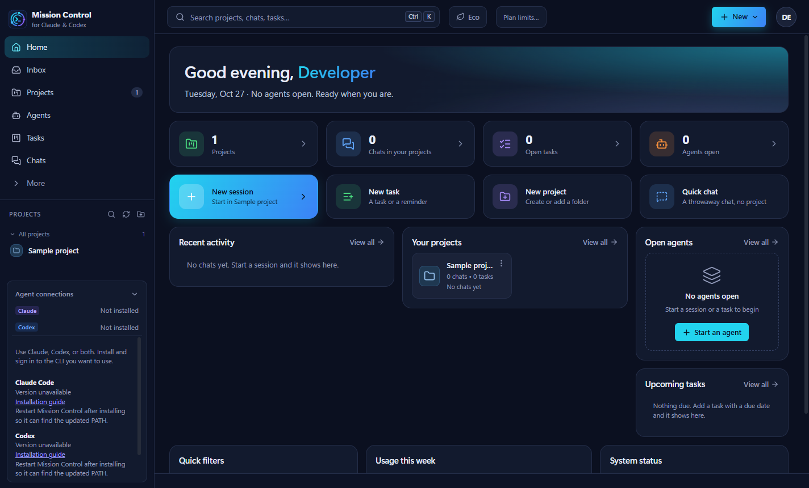
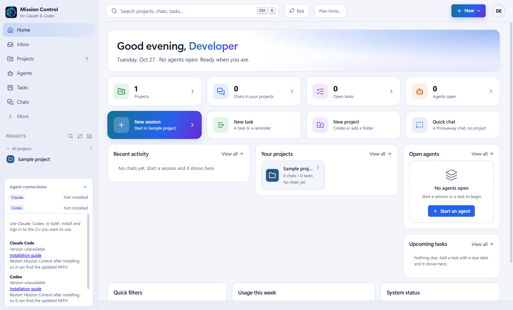

# Mission Control

A Windows desktop workspace for Claude Code and Codex: keep projects, chats, agents, commands and code review together.

[Download the latest Windows installer](https://github.com/Brawly0/mission-control-releases/releases/latest) | [Release notes](https://github.com/Brawly0/mission-control-releases/releases) | [Report a problem](https://github.com/Brawly0/mission-control-releases/issues/new/choose)

## Install

1. Open the latest release and download **Mission-Control-Setup-<version>.exe** under Assets.
2. Run the installer. It installs for your Windows user and adds desktop and Start menu shortcuts.
3. Open Mission Control. **Agent connections** shows whether Claude and Codex are installed and signed in.
4. Follow the installation guide for whichever CLI you want to use, sign in, then restart Mission Control after installation to pick up your updated PATH.
5. Add a project folder, choose Claude or Codex, and start a session.

The app is currently unsigned, so Windows may show an unknown-publisher or SmartScreen notice. Download from this repository's releases and check the published SHA-256 checksum if needed. Follow your organization's software policy.

## Requirements

- Windows 10 or 11, **x64**. Only a Windows x64 installer is provided.
- Native Windows [Claude Code](https://code.claude.com/docs/en/setup), [Codex CLI](https://developers.openai.com/codex/cli/), or both, with access to the provider you choose. Mission Control does not include a provider subscription.
- [Git for Windows](https://git-scm.com/download/win) for branches, worktrees, commits and merge review.
- PowerShell for terminals and project commands; it is included with Windows.

Node.js is not required to install Mission Control. Follow each CLI vendor's instructions for its separate requirements. WSL-only CLI installations are not discovered by this native Windows app.

## What is included

- Projects with saved names, groups, tags and ordering.
- Claude and Codex chats, search, handoffs and shared project briefings.
- Live agents in tabs or a resizable grid, plus a bottom Terminal / Run dock.
- Background tasks, saved workflows and a queue.
- Git changes, verification commands and agent findings before merge.
- Docs, notebook, usage information, light/dark themes and keyboard shortcuts.

## Updates and uninstall

Mission Control checks for updates automatically by default. Use **Settings > Updates** to check manually or change that preference. When an update is ready, choose **Restart and update**. You can also run a newer installer over an existing installation.

Close the app from its tray menu before uninstalling through **Windows Settings > Apps > Installed apps**. Uninstalling preserves settings and task history for a future reinstall. Projects, repositories and CLI chat histories remain separate.

## Your data

Settings and tasks are stored in `%APPDATA%\Mission Control` (the folder name can depend on earlier installations). A previous valid settings file is kept as `store.json.bak`; damaged input is preserved as `store.json.corrupt-<timestamp>` for recovery. Close the app before editing or restoring these files.

The app reads existing Claude/Codex chat history locally. Agent prompts and model-assisted actions go through the selected provider's CLI and account. Claude plan-limit checks use its saved local authentication. Mission Control does not bundle agent credentials. Commands and agents can modify the project you open; review changes and keep Git checkpoints.

## Help

- **Not installed:** open Agent connections, follow the installation guide, restart the app, then refresh the status.
- **Sign in needed:** run `claude auth login` or `codex login` in a terminal. A setup terminal is available before adding a project.
- **Task interrupted:** interrupted runs move to Review with an explanation; inspect the output and continue or rerun.
- **Updates unavailable:** check your internet connection and use the latest installer as a fallback.

Include the app version, Windows version and reproduction steps in a bug report. Remove tokens, private prompts and project paths from screenshots or logs before sharing them in a public issue.

## About this repository

This repository hosts Windows installers, release notes and the auto-update feed. The application source is maintained privately.
